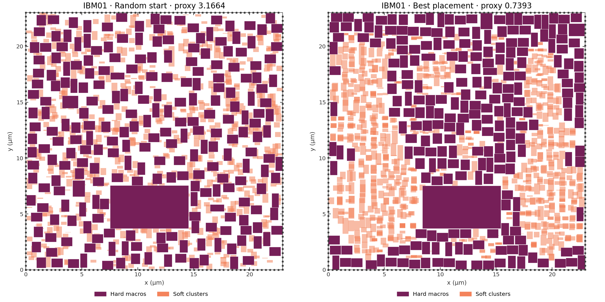

# Ada Place

Ada Place is a macro-placement optimizer using simulated annealing and local refinement. It minimizes a proxy cost combining wirelength, density and routing congestion.

The best saved placements average 0.922 across 17 IBM benchmarks: 36.8% below the challenge's RePlAce baseline and 3.05% below the competition winner. These results were selected across multiple runs after the competition closed.

This repo contains final placements and scores for 17 IBM and four NG45 designs. All pass the official evaluator with zero reported overlaps.

## Placement example

IBM01 contains 246 hard macros and 894 standard-cell clusters connected by 7,269 nets, on a 22.9 × 23.0 µm canvas. The hard macros occupy 42.8% of the canvas and vary roughly 33-fold in area.



## Verify

With [uv](https://docs.astral.sh/uv/getting-started/installation/) installed:

```sh
git clone --recurse-submodules https://github.com/partcleda/macro-place-challenge-2026.git
cd macro-place-challenge-2026
git clone https://github.com/catstat/ada-place.git submissions/ada-place
uv run evaluate submissions/ada-place/placer.py --all
uv run evaluate submissions/ada-place/placer.py --ng45
```

`placer.py` returns saved placements, not the optimizer. Its evaluator runtime is loading time.

## IBM ICCAD04

The challenge scores placements using **wirelength + 0.5 × density + 0.5 × congestion**. Lower is better; this is a placement-quality proxy, not a measurement of chip speed or power.

SA and RePlAce scores are the challenge's published baselines. Percentage reductions use unrounded costs; AVG compares the mean costs.

| Benchmark | Proxy | SA | RePlAce | vs SA | vs RePlAce | Overlaps |
|---|---|---|---|---|---|---|
| ibm01 | 0.739 | 1.317 | 0.998 | +43.8% | +25.9% | 0 |
| ibm02 | 0.872 | 1.907 | 1.837 | +54.3% | +52.5% | 0 |
| ibm03 | 0.892 | 1.740 | 1.322 | +48.7% | +32.5% | 0 |
| ibm04 | 0.821 | 1.504 | 1.302 | +45.4% | +36.9% | 0 |
| ibm06 | 0.984 | 2.506 | 1.619 | +60.7% | +39.2% | 0 |
| ibm07 | 0.946 | 2.023 | 1.463 | +53.3% | +35.4% | 0 |
| ibm08 | 1.008 | 1.924 | 1.429 | +47.6% | +29.4% | 0 |
| ibm09 | 0.751 | 1.387 | 1.119 | +45.9% | +32.9% | 0 |
| ibm10 | 0.952 | 2.111 | 1.501 | +54.9% | +36.6% | 0 |
| ibm11 | 0.801 | 1.711 | 1.177 | +53.2% | +32.0% | 0 |
| ibm12 | 1.046 | 2.826 | 1.726 | +63.0% | +39.4% | 0 |
| ibm13 | 0.841 | 1.914 | 1.335 | +56.1% | +37.1% | 0 |
| ibm14 | 0.959 | 2.275 | 1.544 | +57.8% | +37.8% | 0 |
| ibm15 | 0.950 | 2.300 | 1.516 | +58.7% | +37.3% | 0 |
| ibm16 | 1.002 | 2.234 | 1.478 | +55.1% | +32.2% | 0 |
| ibm17 | 1.071 | 3.673 | 1.645 | +70.8% | +34.9% | 0 |
| ibm18 | 1.032 | 2.776 | 1.772 | +62.8% | +41.7% | 0 |
| **AVG** | **0.922** | **2.125** | **1.458** | **+56.6%** | **+36.8%** | **0** |

## Competition comparison

The [competition's top three finalists](https://github.com/partcleda/macro-place-challenge-2026/blob/996193c83eaad151e5ae3fb166cedbd83372d060/README.md#-leaderboard) are shown below. Ada Place is unranked; "Verified" means verified by the competition judges.

| Rank | Team | Avg proxy | Best | Worst | Overlaps | Time / benchmark (min) | Verified |
|---|---|---|---|---|---|---|---|
| -- | **Ada Place** | **0.922** | **0.739** | **1.071** | **0** | ~17.4* | N |
| 1 | Archgen | 0.951 | 0.757 | 1.184 | 0 | -- | Y |
| 2 | Carrotato | 0.952 | 0.753 | 1.139 | 0 | ~12.4 | Y |
| 3 | JaneRT | 0.969 | 0.725 | 1.216 | 0 | ~47.4 | Y |

\*Timing is from a separate full bench run which resulted in **0.9256 mean proxy over 17,789.56 s**, i.e. 17.44 min/bench, on an AMD Ryzen 9 7950X. This timing is comparable to indepentant runs which resulted in **0.9217 mean proxy**.

## NG45

Four further designs, scored with the same objective.

| Benchmark | Proxy | Wirelength | Density | Congestion | Overlaps |
|---|---|---|---|---|---|
| ariane133 | 0.590 | 0.056 | 0.378 | 0.690 | 0 |
| ariane136 | 0.585 | 0.054 | 0.380 | 0.682 | 0 |
| mempool_tile | 0.676 | 0.074 | 0.520 | 0.684 | 0 |
| nvdla | 0.653 | 0.056 | 0.500 | 0.695 | 0 |
| **AVG** | **0.626** | **0.060** | **0.445** | **0.688** | **0** |

## Files

```text
placer.py
scores.csv
placements/
  ibm01/
    placement.npz
    placement.png
    proxy_maps.png
  ...
```

Each benchmark folder contains final coordinates, a placement plot and proxy maps. IBM01 also includes the before/after image above. [`scores.csv`](scores.csv) keeps full-precision evaluator scores while tables round to three decimal places.
